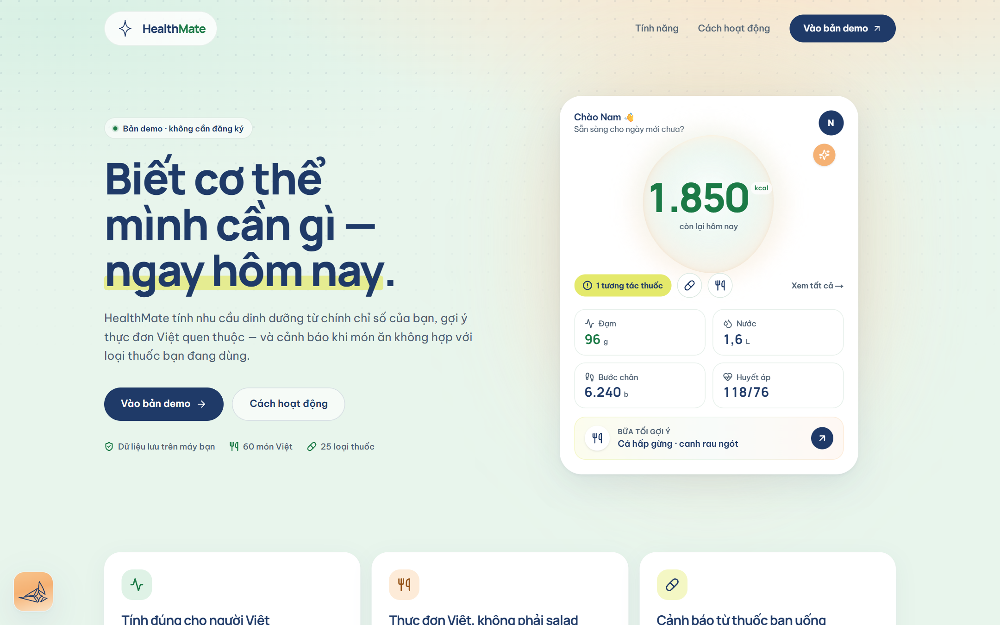
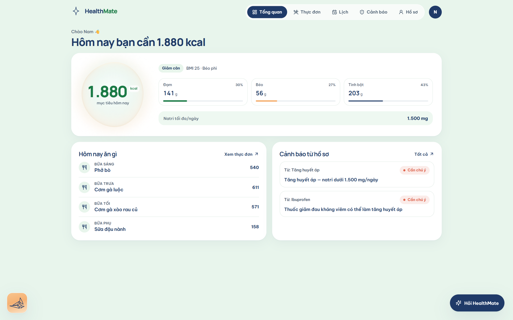
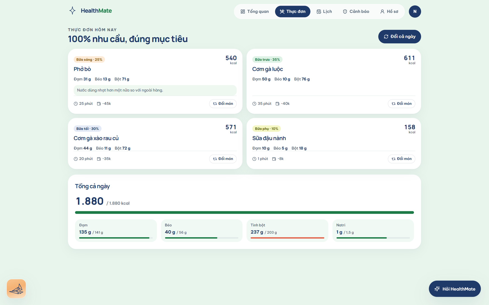
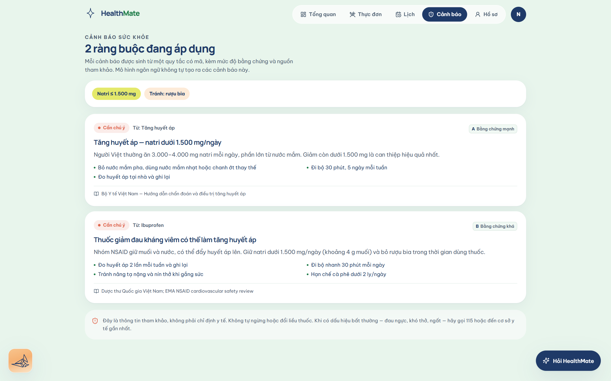
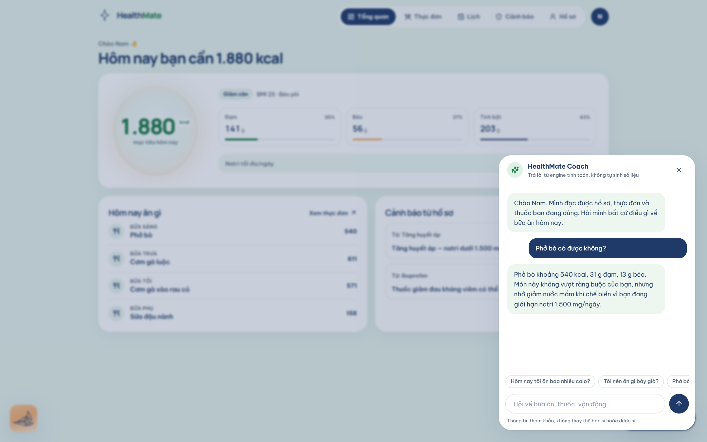
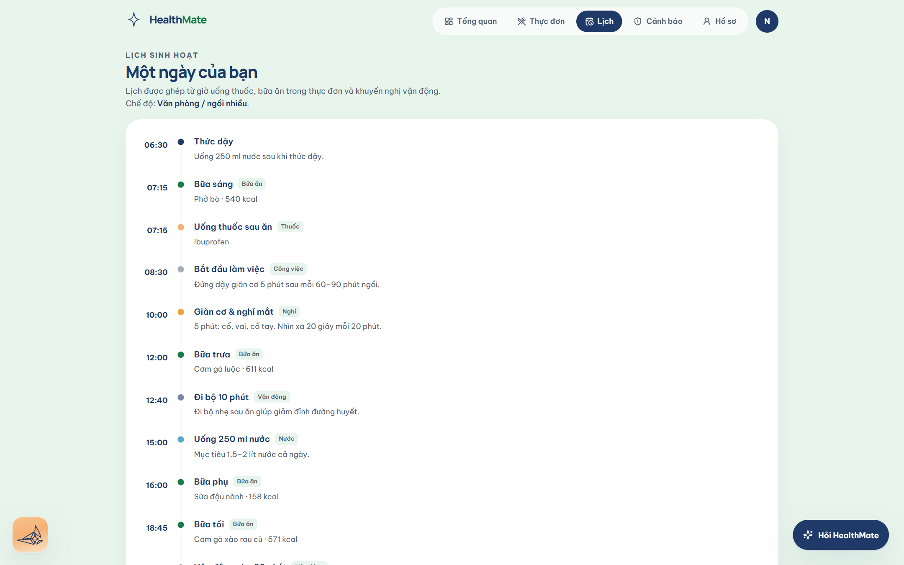
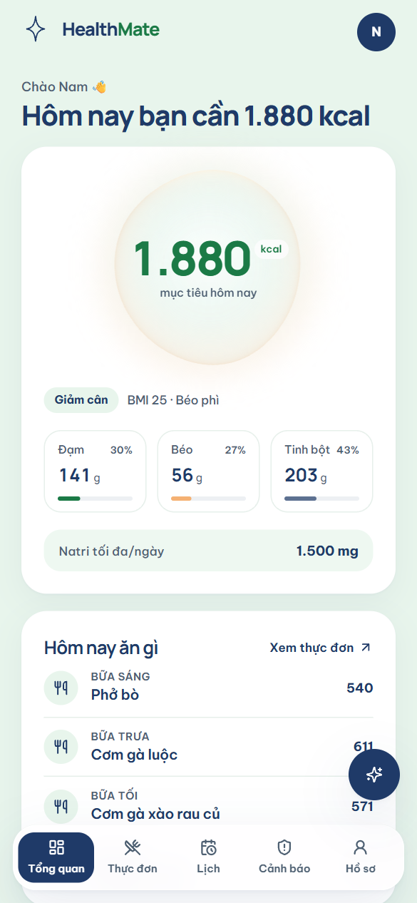

# HealthMate

Trợ lý sức khỏe cá nhân cho người Việt: tính nhu cầu dinh dưỡng, gợi ý thực đơn
hằng ngày, lịch sinh hoạt theo nghề nghiệp và cảnh báo ràng buộc ăn uống dựa trên
thuốc đang dùng.

**[→ Mở bản demo](https://healthmate.example.com/demo)** · không cần đăng ký



> Dự án portfolio. Đây là công cụ tham khảo giáo dục, không phải dịch vụ khám
> chữa bệnh và không thay thế tư vấn của bác sĩ hoặc dược sĩ.

## Vì sao kiến trúc này

Điểm quan trọng nhất: **mô hình ngôn ngữ không làm phép tính dinh dưỡng.**

```
Người dùng
    ↓
Engine tất định          BMR · TDEE · macro · ràng buộc thuốc–thực phẩm · lọc dị ứng
    ↓ dữ liệu có cấu trúc
Coach / LLM              chỉ diễn giải kết quả thành lời khuyên dễ hiểu
    ↓
Validator                chặn đầu ra y tế không an toàn / số liệu không nguồn
    ↓
Giao diện
```

LLM sai số học 15–30% — không dùng được cho dữ liệu sức khỏe. Kiến trúc hybrid
giữ độ chính xác của engine và sự tự nhiên của ngôn ngữ. Coach hiện tại là bản
tất định, chạy được mà không cần API key; lớp gọi model thật nằm sau cùng một
interface.

## Tính năng

- **Tính nhu cầu** — Mifflin–St Jeor, hệ số vận động + nghề nghiệp, ngưỡng BMI
  châu Á, sàn calo an toàn, phân bổ đạm/béo/tinh bột.
- **Thực đơn Việt** — 22 món, macro tính từ nguyên liệu (không nhập tay), tối ưu
  đồng thời calo và đạm, đổi món vẫn giữ mục tiêu.
- **Thuốc & bệnh nền** — 25 hoạt chất, 8 bệnh nền, 17 quy tắc tương tác có mức
  bằng chứng và trích dẫn. Engine tự siết natri, chặn rượu bia, đổi gợi ý vận động.
- **Lịch sinh hoạt** — timeline hợp nhất giờ uống thuốc, bữa ăn và vận động theo
  nghề (văn phòng / ca đêm / lao động chân tay).
- **Coach** — trả lời dựa trên engine, chặn câu hỏi về liều thuốc, chẩn đoán và
  dấu hiệu cấp cứu.

## Ảnh

| Tổng quan | Thực đơn |
|---|---|
|  |  |

| Cảnh báo thuốc | Coach |
|---|---|
|  |  |

| Lịch sinh hoạt | Di động |
|---|---|
|  |  |

## Chất lượng

Đo bằng Lighthouse 12 trên bản production, profile mobile mặc định
(4× CPU throttle, Slow 4G):

| Trang | Performance | Accessibility | Best Practices | SEO |
|---|---|---|---|---|
| `/` | **94** | **100** | **100** | **100** |
| `/demo` | **95** | **100** | **100** | **100** |

- LCP 2,8 s · CLS 0,002 · TBT 120 ms
- `tsc --noEmit` sạch với `strict` + `noUncheckedIndexedAccess`
- Không có runtime error ở `/` và `/demo` (kiểm tự động bằng `scripts/check.mjs`)

## Stack

- **Next.js 15** App Router, Server Components cho landing, client island cho phần tương tác
- **TypeScript strict**
- **Tailwind CSS v4** với design tokens tập trung
- **Three.js / React Three Fiber** — một hiệu ứng duy nhất, lazy-load, tự dừng khi
  ngoài khung nhìn hoặc khi người dùng bật `prefers-reduced-motion`
- **Motion** cho micro-interaction
- Dữ liệu demo lưu client-side để bản công khai không phụ thuộc backend

## Chạy local

```bash
npm install
npm run dev      # http://localhost:3000  →  /demo
npm run build && npm start
```

> Lưu ý: không chạy `npm run build` khi `next dev` đang chạy — cả hai dùng chung
> thư mục `.next`. Nếu gặp lỗi lạ, xoá `.next` rồi chạy lại.

## Cấu trúc

```
src/
├─ app/                 # routes
├─ components/
│  ├─ app/              # workspace, views, coach panel
│  ├─ brand/            # logo, wordmark
│  ├─ landing/          # hero orb, scroll reveal
│  ├─ three/            # hiệu ứng WebGL
│  └─ ui/
├─ core/                # logic thuần — không phụ thuộc React hay DB
│  ├─ nutrition/        # BMR, TDEE, macro, BMI
│  ├─ planner/          # sinh và tối ưu thực đơn
│  ├─ rules/            # ràng buộc từ thuốc và bệnh nền
│  ├─ schedule/         # lịch sinh hoạt theo nghề
│  └─ coach/            # coach tất định + lớp thay thế LLM
├─ data/                # tri thức dạng dữ liệu (thêm món/thuốc = thêm dòng)
└─ lib/
```

## Giới hạn đã biết

- Bộ dữ liệu món ăn ở giai đoạn đầu còn nhỏ, ưu tiên món phổ biến.
- Giá trị dinh dưỡng của món tổ hợp là ước lượng, có trường `source` để phân biệt.
- Chưa hỗ trợ thai phụ, trẻ dưới 18 tuổi và bệnh thận nặng.
- Cảnh báo tương tác thuốc mang tính tham khảo, hiển thị kèm mức bằng chứng.
